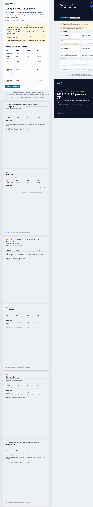
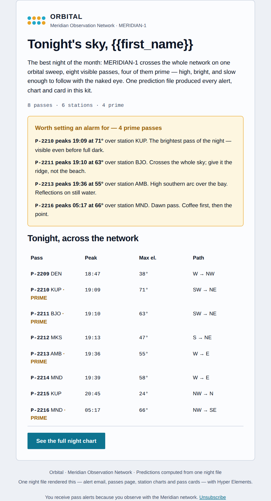
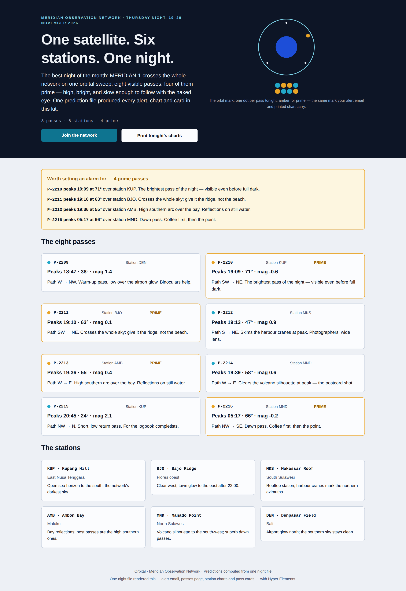
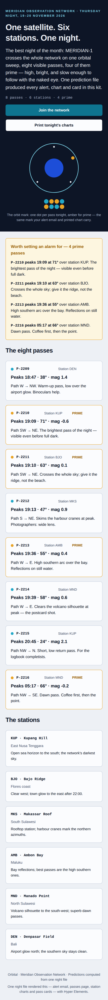
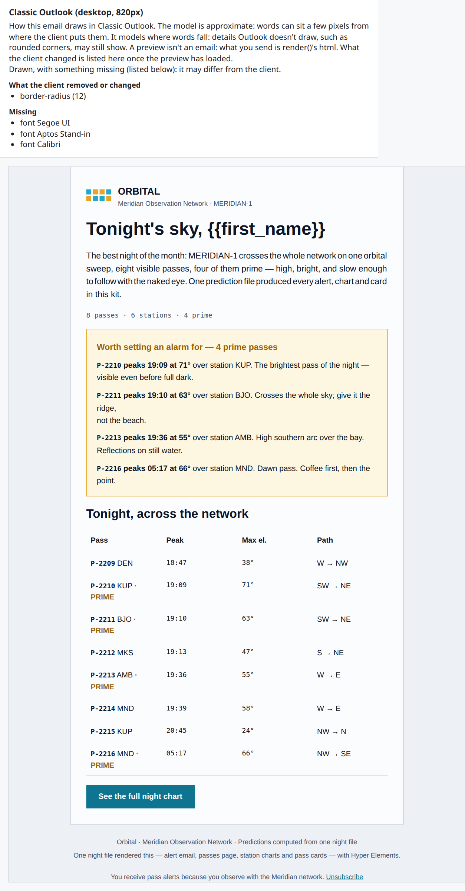
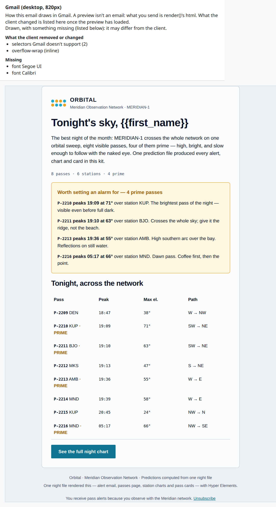

# ORBITAL — Every pass, predicted

A Hyper Elements template kit for a satellite observation network.
**One night file** (`src/data/night.ts`) — eight predicted passes of one
satellite over six stations — renders everything the network publishes
that night: the observer alert emails, the public passes page, the
printed station charts as a real PDF, and the pass cards — from **one
theme** and **one set of shared components**.



*Every screenshot in this README is a photograph of a real render
(`npm run render` + `npm run shots`): if it is pictured, it was rendered.*

**Measured on the demo run (19 Nov 2026):** one night file → **240
personalised observer alerts** (each filtered to the observer's own
station), a **6-page station-chart PDF** (one A4 chart per station),
**8 pass cards** (one per pass) — gate at **0 errors, 0 warnings**,
batch in **12.2s** on a shared VM. Reproduce it:
`npm run check && npm run make`, then read `out/checks.json` and
`out/batch.json`.

| The alert email (600px) | The passes page (desktop) | The passes page (mobile) |
|---|---|---|
|  |  |  |

| The station chart (A4) | The email in Outlook | The email in Gmail |
|---|---|---|
|  |  |  |

The brightest pass as a card is in
[`examples/pass-card.png`](examples/pass-card.png).

## Why one night file?

A pass prediction is a promise with a time on it. If the email says
19:09 and the printed chart says 19:19, someone stands in a field
looking at the wrong sky. This kit makes disagreement impossible by
construction: the alert, the page, the chart and the cards are four
roots over one data file, and "prime" — the passes worth an alarm — is
a **rule in the data** (max elevation ≥ 55° and magnitude ≤ 0.5), not a
label anyone applies by hand. The **OrbitMark** (one dot per pass,
amber for prime) is built from a `Grid` of `Column`s, so the same mark
survives an image-blocking inbox, a printed chart and a social card.

## The four outputs

| Output | Root | Script | What it is |
|---|---|---|---|
| Alert email | `Email` → `render()` | `templates/pass-email.tsx` | Per-observer: prime passes first, then the pass table for *their* station, MergeTag greeting, plain-text twin |
| Passes page | `Page` → `render()` | `templates/pass-page.tsx` | Deep-space hero with Svg orbit art, every pass as a typed `orbital.PassCard`, station grid, no client-side JavaScript |
| Station charts | `Document` → `renderPdf()` | `templates/station-charts-document.tsx` | One A4 chart per station to pin up on site: pass table, full detail, horizon notes, a hand-written observed log |
| Pass cards | `Canvas` → `renderImage()` | `templates/pass-canvas.tsx` | 1080×1080 PNGs, one per pass — peak time and elevation as the heroes, on a deep-space ground |

## Run it

```bash
npm install
npm run check        # validate() gate: core + lint + email-clients -> out/checks.json
npm run render       # one of each output -> out/
npm run clients      # the email as Outlook / Gmail / Apple Mail draw it -> out/clients/
npm run make         # the batch: 240 alerts + charts PDF + 8 cards
npm run make:sample  # same, 12 alerts
npm run shots        # screenshots of the real renders -> docs/
npx hyper-elements check templates/   # 4 templates: 0 errors, 0 warnings, 0 skipped
```

Node 20+. The PDF and PNG steps take their fonts as files — see
`assets/fonts/README.md`. Without them the HTML still renders and the
scripts say exactly what is missing; nothing is ever fetched.

## How Hyper Elements is used

- **One `defineTheme()`** for all four roots: chart paper, deep-space
  ink, signal cyan, named `card` / `stamp` / `mono` styles, Button
  variants, per-format overrides. No `mobile` blocks in the theme —
  phone styles are an error in a Document or a Canvas.
- **Shared components across roots** (`Wordmark`, `OrbitMark`,
  `NightLine`, `PassTable`, `PrimeBlock`) — the emailed pass and the
  printed pass are the same pass.
- **Each root plays to its medium.** The Page gets full `Svg` orbit
  art; the Email, which cannot hold an Svg, gets the OrbitMark as
  layout instead — the same information, drawn the way each medium
  allows.
- **A custom element with `defineElement()`**: `orbital.PassCard`,
  typed props via `prop.text` / `prop.number` / `prop.boolean`. A
  mistyped elevation is a diagnostic with a path, before anything
  renders.
- **`validate()` as a gate**: the batch validates before writing a
  single file; `out/checks.json` makes the verdict an artefact.
- **Token scopes for the dark grounds**: the Page hero and the Canvas
  card invert via `tokens` on a Section/Column — the theme itself never
  changes.
- **Deterministic batch**: observer generation uses no clock and no
  randomness, so a corrections run re-renders only changed records.

## Structure

```
src/theme.ts                  the one theme
src/data/night.ts             the one night file (+ observers)
src/components/shared.tsx     components shared by all four outputs
src/components/pass-card.tsx  orbital.PassCard (defineElement)
templates/                    one default-exported component per output
scripts/                      check / render / clients / make / shots
examples/                     one real artefact of each kind
docs/                         design notes, screenshots
AGENTS.md                     ten invariants an agent must not break
```

## Data & privacy

All data is fictional sample data generated in this repository (the
Meridian network, its stations and MERIDIAN-1 are invented; pass times
are illustrative, not real ephemeris output). No real observers, no
network calls, no credentials, no paid services.

## License

MIT — see `LICENSE`.
